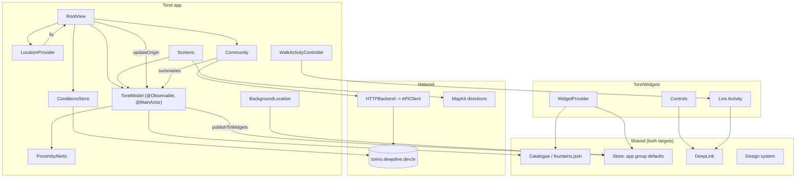
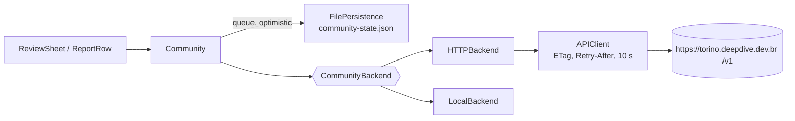

# Architecture

SwiftUI, Swift 6 language mode with approachable concurrency, iOS 26 minimum,
iPhone only. The Xcode project is generated from `project.yml` by XcodeGen
(`Toret.xcodeproj` is git-ignored and regenerated by `make generate`; run that first on a fresh clone).

For the server, see [../backend/api.md](../backend/api.md). For the visual
vocabulary, [../design/poster-system.md](../design/poster-system.md).

## Targets

| Target | Kind | Sources | Notes |
| --- | --- | --- | --- |
| `Toret` | app, `br.tec.nuance.toret` | `Toret/`, `Shared/` | Screens, state, community, intents. |
| `ToretWidgetsExtension` | app extension, `br.tec.nuance.toret.widgets` | `ToretWidgets/`, `Shared/`, fonts | Widget, Live Activity, controls. Embedded in the app. |
| `ToretTests` | unit tests | `ToretTests/` | Depends on `Toret`; `@testable import Toret`. |

`Shared/` is compiled into **both** the app and the extension (there is no framework),
so anything in it must build for both and must not touch app-only singletons.

```
Shared/
  Model/          Fountain, Catalogue, Report, Landmark, DeepLink, Formatting, Store,
                  WalkingRoute, Widget* (state, reading, captions), ToretIntents
  DesignSystem/   Palette, Typography, Poster, Motion, Haptics, Icons, Glass (plate),
                  FountainPlate(+Spec), Parallax*, EmptyScenes, Skyline/ (landmark art)
  Components/     CountingNumber, Needle
  Widgets/        views shared by widgets and the Live Activity
  Resources/      fountains.json, Localizable.xcstrings
Toret/
  Screens/        RootView, Map, Nearby (+Saved), Community, Settings, Detail, Compass,
                  Route, LaunchOverlay, SkylineGallery (Debug)
  Components/     ToretTabBar, Chrome (search, chips, buttons), FountainRow, MapFurniture,
                  Screen, EmptyScene
  State/          ToretModel, LocationProvider, TiltProvider, ProximityAlerts,
                  NotificationRouter, BackgroundLocation, WalkActivityController
  Community/      Community, CommunityBackend, HTTPBackend, APIClient, LocalBackend,
                  persistence, ReviewSheet, ReportRow, NoteFilter, InstallToken
  Conditions/     Conditions (weather, SMAT), ConditionsViews
  Intents/        ToretShortcuts (App Shortcuts provider)
ToretWidgets/     ToretWidgets (bundle), WidgetProvider, WidgetIntents, Controls, WalkLiveActivity
```

## Components and state ownership



### Who owns what

`RootView` (`Toret/Screens/RootView.swift`) creates the objects once with `@State` and
injects them with `.environment(...)`:

| Object | Owns | Lives in |
| --- | --- | --- |
| `ToretModel` | The sorted fountain list, selection, needle angle, map camera, filters, saved IDs, the two switches, tab, per-tab navigation paths, `showingCompass`, `walkingTo`. Persists preferences. | `Toret/State/ToretModel.swift` |
| `LocationProvider` | Raw fix, heading and accuracy, authorization; derives `LocationStatus`. | `Toret/State/LocationProvider.swift` |
| `Community` | Reports, feed, per-fountain `CommunitySummary`, offline queue, blocked/hidden lists, handle. | `Toret/Community/Community.swift` |
| `ConditionsStore` | Weather and (switched-off) works notices, with a disk cache. | `Toret/Conditions/Conditions.swift` |
| `NotificationRouter`, `ProximityAlerts`, `BackgroundLocation`, `WalkActivityController`, `TiltProvider` | Singletons for system-driven things. | `Toret/State/` |

Data flow in one line: **a location fix** (`LocationProvider.coordinate`) goes to
`ToretModel.updateOrigin`, which re-measures all 723 fountains, re-sorts them, swings
the needle by the short delta, publishes the fix to the widgets and re-arms the
geofences. **A community change** (`Community.summaries`) goes to
`ToretModel.apply(summaries:)`, which folds it into each `Fountain`. Views read
`model.fountains`; none of them sorts or measures.

Detail and the walk route re-read their fountain from the model, so they stay current
while the user walks.

## Location

`LocationProvider` runs two separate signals: the fix decides distances, the heading
decides which way the dial turns. Accuracy filter 10 m, heading filter 3 degrees,
`activityType = .fitness`.

`LocationStatus` is the single vocabulary for "why are the distances what they are":

| Case | Meaning | Measured from |
| --- | --- | --- |
| `asking` | Permission not answered | Piazza San Carlo (anchor) |
| `searching` | Authorised, no fix yet | anchor |
| `live` | Fix inside Turin | the user |
| `approximate` | Fix, but Precise Location off | the user |
| `denied` / `restricted` | No permission | anchor |
| `outsideTurin(kilometres:)` | Fix more than 30 km from the centre | anchor |

The anchor is `Catalogue.anchor` (45.06687, 7.68316). `isMeasuringFromUser` gates
everything that would otherwise lie: the dial turning, "arrived", saving "the nearest"
from Siri.

## Catalogue

`Shared/Resources/fountains.json` is built by `tools/build-catalogue.py` from the
Overpass API (`amenity=drinking_water` inside the municipality) and bundled. It is
decoded once per process (`Catalogue.entries`); a missing file leaves the app empty and
`CatalogueMissing` says so. Licence: ODbL ([`DATA-LICENSE.md`](../../DATA-LICENSE.md)),
attribution `© OpenStreetMap contributors (ODbL)` shown in Ajustes and on the detail
page.

## Community stack



- **`CommunityBackend`** (`Toret/Community/CommunityBackend.swift`): the one seam.
  `recent`, `reports(for:)`, `save`, `delete`, `flag`, `availability`, `accountToken`.
  Saves and deletes are idempotent because uploads are retried.
- **`HTTPBackend`** over **`APIClient`**: the production path. Base URL
  `https://torino.deepdive.dev.br` (`APIConfiguration.defaultBaseURL`). The install
  token lives in the Keychain; the server stores only a keyed hash.
- **`LocalBackend`**: a JSON file on the device. It is **not** a runtime fallback for
  when the network is down; it is selected only when no server URL is configured, which
  is a **Debug build launched without `-toret-api`**, and in tests. A Release build
  always uses `HTTPBackend`; being offline is handled by the queue and availability
  `.unavailable` ("waiting for connection").
- **`Community`** is optimistic and offline-first: a report appears instantly, is queued
  (`state.pending`), and `flush()` uploads it in order when the network path returns
  (`NWPathMonitor`) or on refresh. List downloads lag writes by up to a minute, so a
  report just sent is not dropped by a download (`settleTime = 60`).
- **Summaries**: `CommunitySummary.summarising` picks the newest *water* report; if older
  than 36 h the state reverts to `.unknown`. `CommunityHooks` recomputes on every
  foreground because expiry is time-driven.
- **Conditions**: `ConditionsStore` fetches `GET /v1/conditions` every 15 minutes while
  the app is active, keeps the last good copy on disk, and shows weather only if its
  `observedAt` is under 3 hours old. Works notices require `enabled` and a fetch under
  6 hours old; the server flag is off ([data-and-honesty.md](data-and-honesty.md)).

## Widgets and the app group

Group `group.br.tec.nuance.toret` (`Store.appGroup`) is shared by app and extension.

| Key | Written by | Read by |
| --- | --- | --- |
| `toret.saved`, `toret.filters`, `toret.selected`, the two switches | `ToretModel` via `Preferences`; Siri "save" intent | app, widget (saved), intents |
| `toret.origin.lat/lon/date` | `WidgetBridge.publish` (app, background location) | `WidgetProvider`, intents; discarded after 6 hours |
| `toret.widget.cycle` | `CycleFountainIntent` (widget button) | `WidgetProvider`; expires after 10 minutes |

The widget carries its own copy of the catalogue and measures itself; only the user's
position crosses the boundary. It does **not** receive community summaries, so widgets,
controls and Siri never show a community water state. If the group is missing (a
Personal Team build) `Store.defaults` falls back to the process's own defaults and the
widgets show the centre of Turin. With "Bússola sempre visível" off, the published fix
is cleared. `BackgroundLocation` uses significant-change monitoring only when that
switch is on and the permission is "Always", so the widget position stays fresh with the
app closed.

System entry points all converge on `toret://` URLs (`Shared/Model/DeepLink.swift`):
App Intents return `OpenURLIntent(DeepLink...url)`, the Live Activity sets `.widgetURL`,
and `RootView.onOpenURL` is the single router ([navigation.md](navigation.md)).

## Design system module

All in `Shared/DesignSystem/`, no third-party packages. Nothing hard-codes a colour or
a font: `Palette` (inks), `Typo` (League Spartan for the poster, Archivo for reading,
both bundled variable fonts), `Poster`/`Glass` (title, plates, rules, `StateMark`),
`Motion` (curves, springs, Reduce Motion aware), `Icons`, `Haptics`, `FountainPlate`
(deterministic poster per fountain), `ParallaxScene`, `EmptyScenes`, `Skyline/` (drawn
landmarks). `Glass.swift` keeps its old name but now draws flat plates. Legacy
colour names in `Palette` still exist and map onto the poster inks.

The app forces the light colour scheme (`ToretApp`); the compass forces dark.

## Build, run, test

| Command | What it does |
| --- | --- |
| `make generate` | `xcodegen generate` from `project.yml` |
| `make run` | Generate, boot the simulator (`SIM`, default iPhone 17 Pro), set location (`LOCATION`, default central Turin), build Debug to `build/sim`, install, grant location, launch |
| `make test` | Generate, run the whole `Toret` scheme on the simulator |
| `make device` | Build, sign, install and launch on a connected iPhone (`TEAM`, `DEVICE`, `GROUPS=NO` for a Personal Team); see the notes above the target in the `Makefile`. `CONFIG` is referenced but has no default in the `Makefile`, so pass `CONFIG=Debug` or `CONFIG=Release` |
| `make archive` / `make testflight` | Release archive / upload to TestFlight (`UPLOAD=NO` rehearses) |
| `make clean` | Remove `build/` |

Strings: `tools/l10n.py`, `tools/check-localization.py`
([../localization.md](../localization.md)). Catalogue: `tools/build-catalogue.py`.
Screenshots per language: `tools/l10n-screenshots.sh`.

## Tests

Swift Testing (`import Testing`), 17 files in `ToretTests/`, run in `pt-BR`/`BR` by the
scheme because the tests assert the app's own wording (`LocalizationTests` covers the
other languages explicitly). Coverage by area: bearings and compass math
(`ToretTests`, `CompassTests`), catalogue and model, community store and queue
(`CommunityStoreTests`), the HTTP client against a stub server (`HTTPBackendTests`,
`StubServer`), conditions (`ConditionsTests`), widget logic and rendering
(`WidgetLogicTests`, `WidgetRenderTests`), list/map/detail layout, fountain plates,
parallax, skyline, empty scenes, icons, localization.

A full run on 2026-10-12 (`xcodebuild test`, iPhone 17 Pro simulator, working tree on
`main`) reported `Test run with 294 tests in 57 suites passed`. Parameterized tests are
counted by Swift Testing, so this is the run count, not a count of `@Test` lines. The
tests run on the simulator only; none exercises a real sensor, widget host or Live
Activity.
