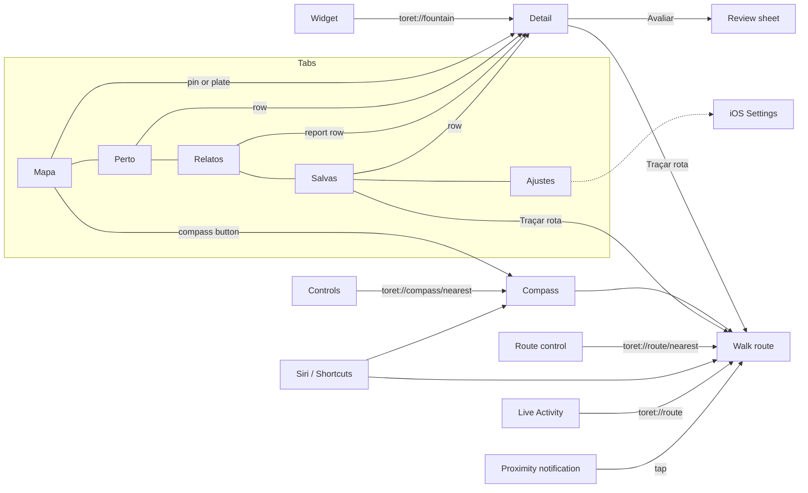

# Toret: product overview

Toret is a free iPhone app (iOS 26, SwiftUI, Swift 6) that finds the public drinking
fountains of Turin, walks you to one, and lets people standing at a fountain say
what the water is doing.

> **The promise:** the nearest drinking water in Turin, how far, which way, and
> only what we can honestly say about it.

The name is the Piedmontese word *toret*: the cast-iron bull's-head columns that
have served the city since the 19th century. The interface calls every public
drinking fountain a *fonte* ("fountain"); only the app is named after the bull
(`Shared/Model/Fountain.swift`). See the [glossary](glossary.md).

## Who it is for

- **Someone walking in Turin who is thirsty**, a visitor or a resident: they want
  the closest water and a direction, in seconds, often outdoors in bright sun.
- **Someone with a bottle, a dog or a wheelchair**: the map filters on exactly
  those (`Shared/Model/MapFilter.swift`).
- **People who pass a fountain and have something to add**: a report of the water,
  a rating, a line of text, with no account.

## The catalogue and its limits

| Fact | Value | Source |
| --- | --- | --- |
| Fountains | 723 | `Shared/Resources/fountains.json` |
| Classic toret | 184 | same file (`kind: toret`) |
| Other kinds | 496 public fountains, 33 bubblers, 10 bottle refills | same file |
| Neighbourhoods named | 35 | same file (`zone`) |
| Origin | OpenStreetMap, bundled, ODbL | [`DATA-LICENSE.md`](../../DATA-LICENSE.md) |

The app has **no live per-fountain data**. Nobody publishes whether a given
fountain is running. See [data-and-honesty.md](data-and-honesty.md).

## Product boundaries

- **Turin only.** The catalogue covers the municipality; a fix more than 30 km from
  the old town is reported as "outside Turin" and distances stay measured from
  Piazza San Carlo (`Catalogue.radius`, `LocationStatus.outsideTurin`).
- **Free.** No price, no purchases, no ads (`docs/appstore/metadata.md`).
- **No accounts.** Writes carry a random per-install token; the handle is
  "Visitante" plus six hex digits (`Toret/Community/InstallToken.swift`,
  `CommunityBackend.swift`).
- **No tracking.** The only server is ours, for reports and weather
  ([architecture.md](architecture.md)).
- **No live water data.** A fountain is "sem relato recente" until a dated
  community report says otherwise, for at most 36 hours.
- **iPhone only, portrait only** (`project.yml`: `TARGETED_DEVICE_FAMILY: "1"`).

## The five tabs

The tab bar is `Mapa · Perto · Relatos · Salvas · Ajustes` (en: Map, Nearby, Reports,
Saved, Settings; it: Mappa, Vicino, Segnalazioni, Salvate, Opzioni). Defined in
`Toret/State/ToretModel.swift` (`Tab`), drawn in `Toret/Components/ToretTabBar.swift`.

| Tab | For | Screen doc |
| --- | --- | --- |
| **Mapa** | See every fountain around you, search a street or square, filter, pick one. The default tab. | [map](screens/map.md) |
| **Perto** | The nearest fountains as a list with the distance as the big figure. | [nearby](screens/nearby.md) |
| **Relatos** | The community feed: recent reports across the city, newest first. | [community](screens/community.md) |
| **Salvas** | Fountains you saved, nearest first, along your usual route. | [saved](screens/saved.md) |
| **Ajustes** | Permissions, the two outside-the-app switches, data credits, privacy. | [settings](screens/settings.md) |

## Surfaces that are not tabs

| Surface | What it is | Opens from |
| --- | --- | --- |
| **Compass** | Full screen, night plate; one big distance, a needle, landmarks on the rim. | Map button, `toret://compass`, Control Center, Siri |
| **Fountain detail** | The fountain's own plate, state, three figures, community, facts. Pushed onto the current tab's stack. | Any list or pin, `toret://fountain/<id>` |
| **Walk route** | Full screen turn-by-turn, one instruction at a time. | Detail, Map plate, Saved, `toret://route/...`, the proximity notification |
| **Review sheet** | Rate a fountain and report its water. | Detail, community section |
| **Home and Lock Screen widget** | Nearest (or nearest saved) fountain, one widget in six sizes. | Home, Lock Screen, StandBy |
| **Live Activity** | The walk on the Lock Screen and in the Dynamic Island. | Starts with a walk |
| **Controls** | "Fonte mais próxima" and "Rota até a fonte". | Control Center, Lock Screen, Action Button |
| **Siri and Shortcuts** | Four App Shortcuts: nearest, compass, route, save nearest. | Siri, Spotlight, Shortcuts |
| **Proximity notification** | "Fonte a 100 m", tap goes to the route. | A geofence round the nearest fountains |

Details of each live under [docs/app/screens/](screens/): [compass](screens/compass.md),
[detail](screens/detail.md), [route](screens/route.md),
[system surfaces](screens/system-surfaces.md), [launch](screens/launch.md),
[empty states](screens/empty-states.md).

## You do not need to open the app

The product is built so that the answer is often one glance away:

1. **Lock Screen or home widget**: the distance and direction to the nearest
   fountain (`ToretWidgets/ToretWidgets.swift`, families `systemSmall/Medium/Large`
   and `accessoryCircular/Rectangular/Inline`).
2. **Control Center or the Action Button**: one tap opens the compass already
   pointing at the nearest fountain, or starts the walk (`ToretWidgets/Controls.swift`).
3. **Siri**: "Qual a fonte mais próxima no Toret" answers aloud
   (`Toret/Intents/ToretShortcuts.swift`).
4. **A notification** when you pass within 100 m of one (never says the water is
   running; at most it repeats the last community report).
5. **The walk** continues on the Lock Screen and Dynamic Island.

Widgets and Siri measure from the last fix the app published into the shared app
group, or take their own one-shot fix, and they carry the catalogue only: they never
show a community water state (see [data-and-honesty.md](data-and-honesty.md)).

## Screen map

Deep-link behaviour is specified in [navigation.md](navigation.md).

## Status

"Built" means it exists in the code, the unit tests pass and it has been run in the
**simulator**. Nobody has recorded a hardware check of the items marked "not
verified"; treat them as unproven until someone does.

| Area | Built | Verified in simulator or tests | Verified on a real device |
| --- | --- | --- | --- |
| Catalogue, distances, bearings | Yes | Yes (unit tests) | Not recorded |
| Map, Perto, Relatos, Salvas, Ajustes, detail | Yes | Yes (screenshots, `ListScreensTests`, `MapLayoutTests`) | Not recorded |
| Walking route (MapKit, straight-line fallback) | Yes | Partly | **Not verified** |
| Compass needle turning with the phone | Yes | Heading is pinned in Debug (`-toret-heading`) | **Not verified**: no magnetometer in the simulator |
| Community over HTTP, queue, block, flag, delete | Yes | Yes (`HTTPBackendTests`, `CommunityStoreTests`, one test report against the live server) | Not recorded |
| Weather line (Open-Meteo via our server) | Yes | Yes (`ConditionsTests`) | Not recorded |
| SMAT works notices | Implemented, **off** | Yes (tests) | n/a, see [data-and-honesty.md](data-and-honesty.md) |
| Widgets (six families) | Yes | Render tests (`WidgetRenderTests`) | **Not verified** on Home/Lock Screen/StandBy |
| Live Activity and Dynamic Island | Yes | Not in the simulator UI | **Not verified** |
| Control Center controls, Action Button | Yes | No | **Not verified** |
| Siri phrases, Shortcuts | Yes | Phrase set checked by `check-localization.py` | **Not verified** |
| Proximity notification (CLMonitor, 100 m) | Yes | No | **Not verified** |
| "Always" location, background widget refresh | Yes | No | **Not verified** |
| 60 fps scrolling and parallax, launch motion | Yes | Visual checks in simulator | **Not verified** |
| Dynamic Type, VoiceOver, Reduce Motion | Partly | Code review only | **Not verified**, see [accessibility.md](accessibility.md) |
| pt-BR, English, Italian | Yes, 379 strings | `LocalizationTests`, screenshots | n/a |

A device install has been attempted: the `Makefile` records the signing outcomes of
2026-10-10 (a Personal Team cannot provision the App Group, so widgets fall back to
the centre of Turin; `make device GROUPS=NO`). That is a signing note, not a feature
check. The App Store and TestFlight steps are in [`DISTRIBUICAO.md`](../../DISTRIBUICAO.md).

## Where to go next

- Principles behind the screens: [ux-principles.md](ux-principles.md)
- How it is built: [architecture.md](architecture.md)
- What each datum may claim: [data-and-honesty.md](data-and-honesty.md)
- Visual identity: [../design/poster-system.md](../design/poster-system.md)
- Everything under `docs/`: [../README.md](../README.md)
